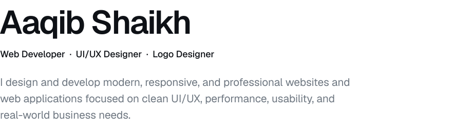
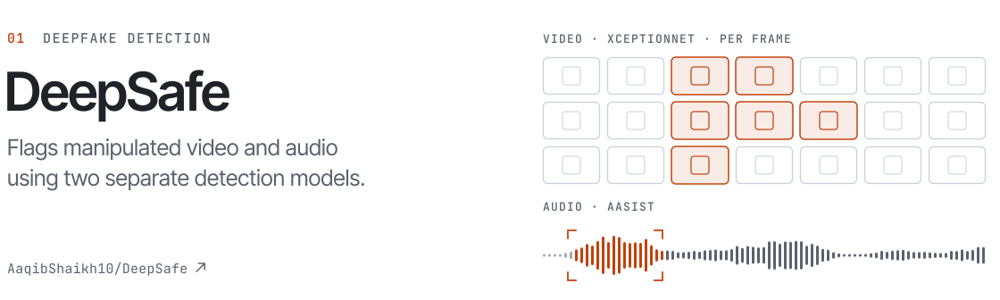
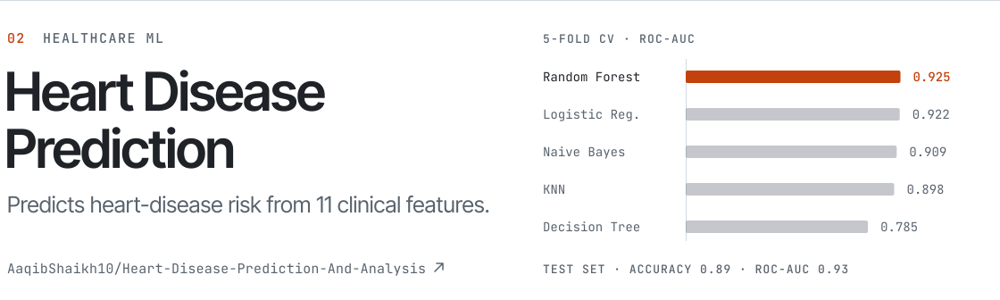
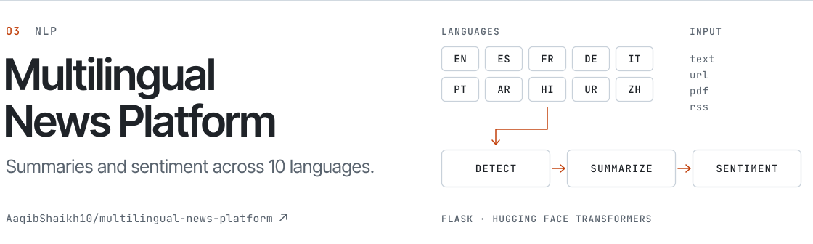
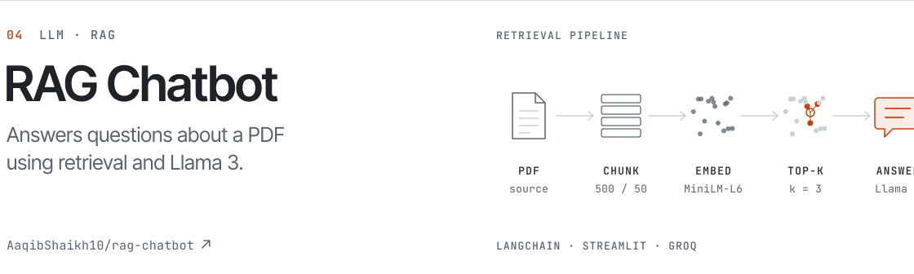
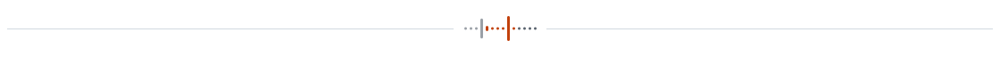

<!--
  Profile README for github.com/AaqibShaikh10
  Artwork: assets/*-light.svg and assets/*-dark.svg, switched by GitHub theme.
  To edit the artwork, change assets/source/build_assets.py and re-run it.
-->

<picture>
  <source media="(prefers-color-scheme: dark)" srcset="assets/hero-dark.svg">
  
</picture>

Software engineer working across machine learning and full-stack development. Most of my work sits where the two meet: models for deepfake detection, healthcare prediction and language processing, wrapped in web applications that people can use. Right now that means **DeepSafe**, which checks video and audio for signs of manipulation.

**Focus** &nbsp;AI and machine learning · deepfake detection · healthcare AI · full-stack development 
**Learning** &nbsp;advanced deep learning · LLMs · RAG architectures · MLOps

[Selected work](#selected-work) &nbsp;·&nbsp; [Email](mailto:aaqibshaikh300@gmail.com) &nbsp;·&nbsp; [LinkedIn](https://www.linkedin.com/in/aaqib-shaikh-432b26306/)

## Selected work

<a href="https://github.com/AaqibShaikh10/DeepSafe">
  <picture>
    <source media="(prefers-color-scheme: dark)" srcset="assets/project-deepsafe-dark.svg">
    
  </picture>
</a>

A full-stack deepfake detector that started as my final-year project. Uploaded video is sampled into frames, faces are detected, and each face is classified by an XceptionNet model trained on FaceForensics++, with a majority vote deciding the result. Audio runs through AASIST, a graph-attention model trained on ASVspoof 2019. The app adds user accounts, detection history, an admin dashboard and downloadable PDF reports.

`Python` `Django` `React` `TypeScript` `TensorFlow` `PyTorch` `PostgreSQL` `Docker`

<a href="https://github.com/AaqibShaikh10/Heart-Disease-Prediction-And-Analysis">
  <picture>
    <source media="(prefers-color-scheme: dark)" srcset="assets/project-heart-disease-dark.svg">
    
  </picture>
</a>

A data-mining project on the UCI heart disease dataset (918 records after cleaning). I compared five classifiers with stratified cross-validation, tuned the strongest, and the Random Forest reached 89% accuracy and 0.93 ROC-AUC on the held-out test set. A FastAPI service serves predictions to a React front end that also shows the model reports and charts.

`Python` `scikit-learn` `FastAPI` `React` `TypeScript`

<a href="https://github.com/AaqibShaikh10/multilingual-news-platform">
  <picture>
    <source media="(prefers-color-scheme: dark)" srcset="assets/project-multilingual-news-dark.svg">
    
  </picture>
</a>

A Flask app that takes a news article as text, a URL, a PDF or an RSS feed, detects its language, then produces an abstractive summary and a sentiment label using Hugging Face transformer models. It supports English, Spanish, French, German, Italian, Portuguese, Arabic, Hindi, Urdu and Chinese.

`Python` `Flask` `Transformers` `langdetect`

<a href="https://github.com/AaqibShaikh10/rag-chatbot">
  <picture>
    <source media="(prefers-color-scheme: dark)" srcset="assets/project-rag-chatbot-dark.svg">
    
  </picture>
</a>

A Streamlit chat app that answers questions about a PDF. The document is split into overlapping chunks and embedded with all-MiniLM-L6-v2; each question retrieves the three closest chunks, which LangChain hands to Llama 3 running on Groq. Conversations can be exported as text.

`Python` `LangChain` `Streamlit` `Groq` `Sentence Transformers`

## Toolkit

| Area | Tools |
| :--- | :--- |
| Languages | Python · TypeScript · JavaScript · Dart · C++ |
| Frameworks | React · Next.js · Flutter · FastAPI · Flask · Django |
| AI / ML | TensorFlow · PyTorch · scikit-learn · Hugging Face · LangChain |
| Data and tooling | PostgreSQL · MongoDB · Firebase · Docker · Git |

## Now

| Focus | Status |
| :--- | :--- |
| **DeepSafe** — multi-modal deepfake detection | In progress |
| **LLMs and RAG** — building systems on language models | Learning |
| **Healthcare AI** — applying ML to clinical data | Exploring |
| **MLOps** — production-ready ML pipelines | Building |

## Contact

Open to collaborating on AI/ML and full-stack projects.

**Email** &nbsp;[aaqibshaikh300@gmail.com](mailto:aaqibshaikh300@gmail.com) 
**LinkedIn** &nbsp;[aaqib-shaikh-432b26306](https://www.linkedin.com/in/aaqib-shaikh-432b26306/) 
**GitHub** &nbsp;[@AaqibShaikh10](https://github.com/AaqibShaikh10)

<picture>
  <source media="(prefers-color-scheme: dark)" srcset="assets/footer-dark.svg">
  
</picture>
