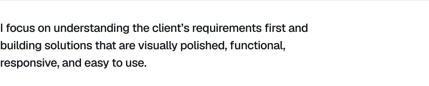

<!--
  Typeset in Geist. All text artwork is generated by assets/source/build.py
  (light + dark versions, switched automatically by GitHub's theme).
-->

<picture>
  <source media="(prefers-color-scheme: dark)" srcset="assets/hero-dark.svg">
  
</picture>

<a href="https://aaqibshaikh.dev"><picture><source media="(prefers-color-scheme: dark)" srcset="assets/link-portfolio-dark.svg"></picture></a>
<a href="https://www.aaqibshaikh.dev/assets/files/aaqib-shaikh-cv.pdf"><picture><source media="(prefers-color-scheme: dark)" srcset="assets/link-resume-dark.svg"></picture></a>
<a href="https://www.freelancer.com/u/AaqibShaikh10"><picture><source media="(prefers-color-scheme: dark)" srcset="assets/link-freelancer-dark.svg"></picture></a>
<a href="https://www.linkedin.com/in/aaqibshaikh10/"><picture><source media="(prefers-color-scheme: dark)" srcset="assets/link-linkedin-dark.svg"></picture></a>
<a href="mailto:aaqibshaikh300@gmail.com"><picture><source media="(prefers-color-scheme: dark)" srcset="assets/link-email-dark.svg"></picture></a>

 

<picture>
  <source media="(prefers-color-scheme: dark)" srcset="assets/services-dark.svg">
  
</picture>

 

<picture>
  <source media="(prefers-color-scheme: dark)" srcset="assets/stack-dark.svg">
  
</picture>

 

<picture>
  <source media="(prefers-color-scheme: dark)" srcset="assets/closing-dark.svg">
  
</picture>
